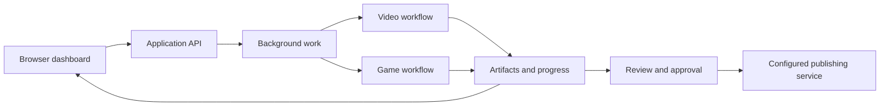

# Aether Nexus
### Creator workflow orchestration · Full-stack engineering portfolio

Aether Nexus is a self-hosted mission-control application that coordinates AI-assisted video production and Roblox game creation. It brings long-running jobs, generated artifacts, progress updates, and review controls into one browser dashboard.

The engineering challenge is coordinating a workflow that can take minutes, depend on several providers, and fail partway through—while keeping its progress understandable and its outputs reviewable.

**Project status:** Private application with a public documentation showcase. This repository describes features found in the inspected implementation through its September 2026 provider-diagnostics update. It does not distribute the working application or claim independently verified production results.

[Architecture](docs/architecture.md) · [Engineering decisions](docs/engineering.md) · [Demo walkthrough](docs/demo.md) · [Small code example](examples/README.md)

## Key capabilities

| Capability | What the application implements |
| --- | --- |
| Mission Control | A browser dashboard with job progress, event history, and artifact previews/downloads. |
| YouTube Factory | Script and scene planning, optional research, narration and media integration, local rendering, subtitles, thumbnails, and publishing controls. |
| Roblox Forge | Structured game planning, Luau project generation, static checks, and Rojo-compatible ZIP / Roblox XML place packaging. |
| Resumable work | Saved intermediate results and checkpoints that allow eligible work to resume after interruption or provider failure. |
| Review and scheduling | Artifact review, approval checks, recurring production rules, and scheduled dispatch. |
| Provider diagnostics | Bounded error categories and selected metadata designed to avoid copying raw provider responses into user-visible errors. |

External generation and publishing depend on provider availability, configuration, and account permissions. A generated Roblox package still needs play-testing in Roblox Studio.

## System at a glance



This diagram summarizes the product flow; it intentionally omits internal prompts, routing rules, generation templates, and recovery algorithms.

## Technology stack

| Layer | Technologies present in the private project |
| --- | --- |
| Interface | HTML, CSS, JavaScript; REST requests and Server-Sent Events |
| API and validation | Python, FastAPI, Pydantic |
| Persistence | SQLAlchemy; PostgreSQL in the Docker configuration, SQLite support in the database layer |
| Background processing | Celery, Redis, Celery beat; an inline execution path is also present |
| Media and game artifacts | FFmpeg, Pillow, Luau, Rojo-compatible project files, RBXLX |
| Integrations | OpenRouter, local model support, Higgsfield integration code, YouTube Data API, Roblox Open Cloud, Discord |
| Delivery and testing | Docker Compose, Windows PowerShell tooling, pytest |

These are implementation technologies, not a claim that every integration is enabled in the current installation.

## Engineering highlights

- **Long-running work outside the request cycle.** Background jobs let the dashboard remain available while rendering and generation continue.
- **Recovery as part of the workflow.** Persisted progress and artifacts support resuming eligible stages rather than discarding every successful step.
- **Care around external side effects.** Publishing has separate controls, and failed publish attempts return to review instead of automatically retrying.
- **Useful diagnostics with limited disclosure.** Provider failures are translated into controlled categories rather than exposing entire responses.
- **A consistent interface across two domains.** Video and game workflows share mission tracking, artifacts, events, and review concepts.

See [engineering decisions](docs/engineering.md) for tradeoffs and verification limits.

## Screenshots and demonstration

Screenshot slots are documented in [assets/screenshots/README.md](assets/screenshots/README.md). No live account screenshots or demonstration recording are included yet.

The [demo walkthrough](docs/demo.md) outlines a short private presentation using synthetic content: follow a mission, inspect an output, explain a pause, and stop at review. It is a proposed walkthrough, not a record of a completed demonstration.

## Explore this repository

```text
aether-nexus-showcase/
├── README.md
├── docs/
│   ├── architecture.md
│   ├── engineering.md
│   └── demo.md
├── assets/screenshots/
│   └── README.md
├── examples/
│   ├── README.md
│   └── public-status.mjs
└── .gitignore
```

The example is a newly written, dependency-free illustration of exposing only a small set of public status fields. It is not extracted production code and cannot operate the application.

## Scope and availability

The application source, credentials, configuration, datasets, generation logic, and deployment packages remain private. This repository contains documentation and one standalone illustrative example; there is no application installation command or public service to connect to.

The inspected private repository contains tests for API behavior, secret handling, publishing controls, research authorization, and provider diagnostics. Those tests were inspected, not rerun as part of preparing this showcase. No performance, revenue, user-count, or production reliability claims are made.

For a technical interview, the most useful discussion topics are asynchronous job design, failure recovery, artifact review, API integration, and the tradeoffs between local and external AI services.
