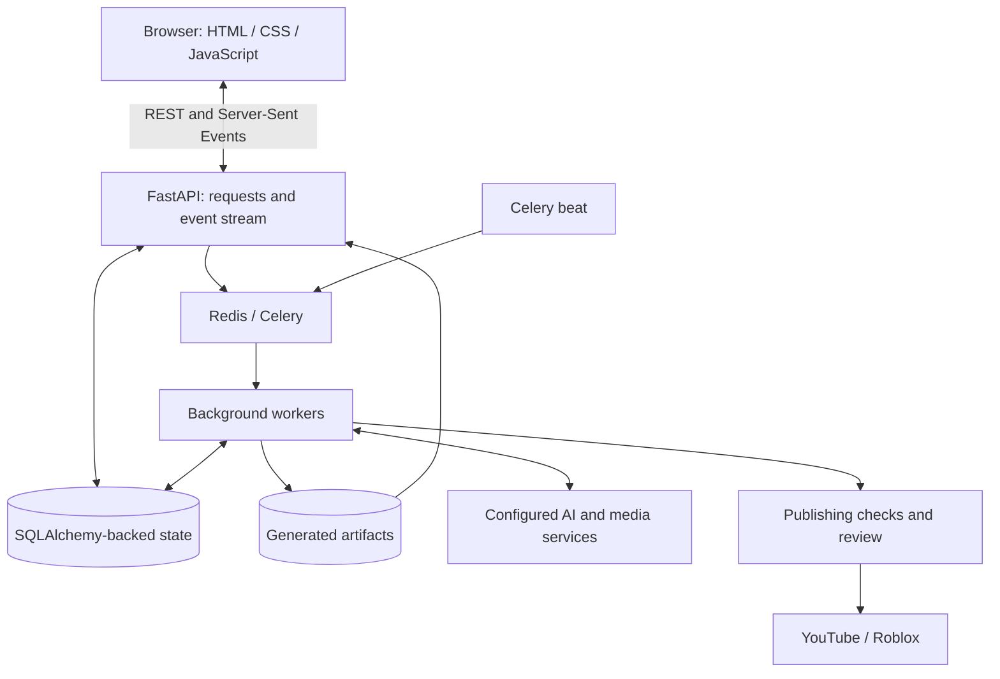

# Architecture overview

Aether Nexus separates the user interface, application state, background work, and external services. This is a conceptual summary of the inspected code, not a deployment specification.

## Responsibilities

| Component | Responsibility |
| --- | --- |
| Dashboard | Capture a brief, display mission state, and support artifact inspection. |
| API | Validate inputs, expose state, accept user actions, and stream events. |
| Persistence | Store missions, events, settings, artifact metadata, and encrypted connection records. |
| Workers | Execute the video and game workflows and persist progress. |
| Scheduler | Dispatch recurring work and scheduled operations. |
| Service integrations | Encapsulate provider requests and platform interactions. |

The diagram shows the Docker worker arrangement. The source also supports an inline execution path; deployment behavior depends on configuration. PostgreSQL is declared in Docker Compose, while the database layer includes SQLite-specific handling.

## Workflow summary

1. A user supplies a video or game brief.
2. The application records a mission and starts background work.
3. The workflow produces intermediate outputs, progress events, and downloadable artifacts.
4. Eligible interrupted work can reuse saved results. Recovery depends on the stage and failure type.
5. Generated work enters the applicable review and publishing controls.
6. A configured platform integration can publish approved work; provider errors remain visible for review.

Review controls and automation options coexist in the private project. This overview does not imply that every configuration requires an identical manual step.

## Private boundary

This showcase omits internal API contracts, prompts, model-selection rules, generation templates, detailed state transitions, retry algorithms, deployment configuration, and provider credentials. The architecture communicates responsibilities without supplying the application implementation.
